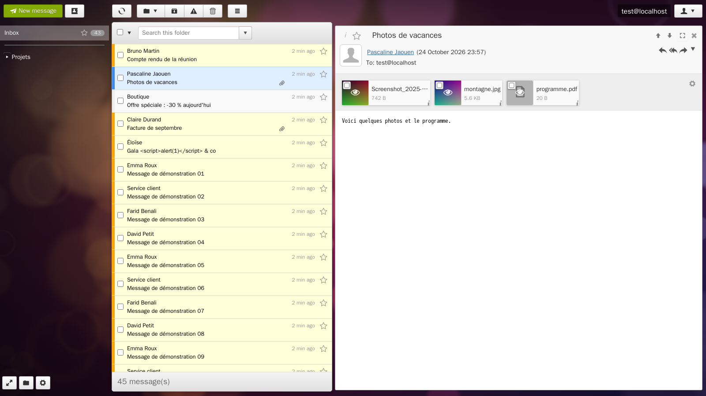
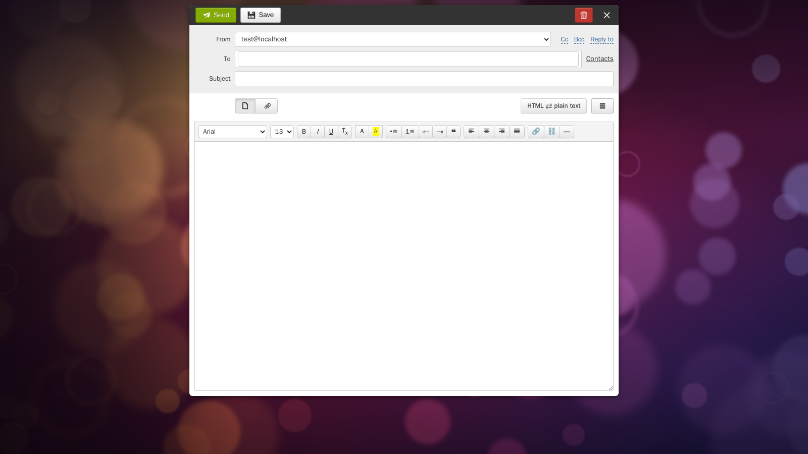
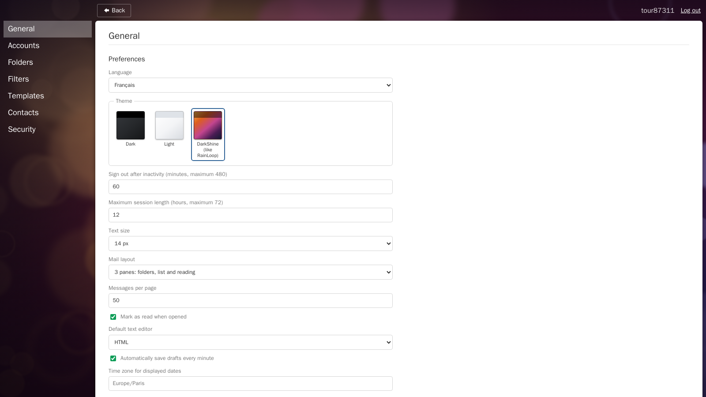

# wmail-go

[](https://github.com/gdegoulet/wmail-go/actions/workflows/ci.yml)
[](LICENSE)
[](go.mod)

Webmail en Go (IMAP, SMTP, ManageSieve) qui reprend l'ergonomie et les fonctions de **RainLoop 1.17**, dont son
thème DarkShine. Écrit parce que RainLoop n'est plus maintenu et qu'aucun successeur ne proposait la même
interface.

**Ce qui le caractérise**

- **Un binaire statique de ~18 Mo**, sans base de données : vos messages restent sur votre serveur IMAP.
- **Aucun mot de passe stocké** : un fichier chiffré par utilisateur (argon2id + XChaCha20-Poly1305), ouvert par le
  mot de passe ou la clé de récupération. Voir [`SECURITY.md`](SECURITY.md).
- **Interface sans cadriciel JavaScript**, utilisable sans JavaScript, servie par des gabarits côté serveur.
- **Développement et tests entièrement en conteneurs** : rien à installer sur votre poste à part Docker ou Podman.
- Français et anglais, thèmes, trois dispositions, raccourcis clavier, filtres Sieve, carnet d'adresses CardDAV.

État : **utilisable au quotidien**, en validation ; voir [`AVANCEMENT.md`](AVANCEMENT.md) et la trame de test.



<details>
<summary>Autres captures : composition, réglages</summary>





</details>

| Document | Contenu |
|---|---|
| [`SECURITY.md`](SECURITY.md) | modèle de menace, chiffrement, sessions, affichage des messages, signalement |
| [`CONTRIBUTING.md`](CONTRIBUTING.md) | construire, tester, structure du dépôt, règles de code |
| [`CAHIER_DES_CHARGES.md`](CAHIER_DES_CHARGES.md) | décisions de conception, inventaire fonctionnel de RainLoop |
| [`MATRICE_DE_TEST.md`](MATRICE_DE_TEST.md) | 165 points de validation, un par fonctionnalité |
| [`CHANGELOG.md`](CHANGELOG.md) | journal des changements |
| [`docs/PUBLICATION.md`](docs/PUBLICATION.md) | vérifications avant publication du dépôt |
| [`docs/audit-rainloop/`](docs/audit-rainloop/) | analyse fonction par fonction de RainLoop 1.17 (PHP, JS, gabarits, CSS) |

## Démarrer sur le poste de travail

```
make up                  # http://127.0.0.1:8080
make mail-up mail-seed   # GreenMail (IMAP/SMTP de test) et messages de démonstration
make user-add LOGIN=alice   # crée un compte webmail (mot de passe demandé)
make logs                # journaux du serveur
```

Les données d'un utilisateur sont chiffrées (un fichier par utilisateur, aucun mot de passe stocké) ; la configuration
se trouve dans `config/config.json`. Aucun test n'accède à une vraie boîte : uniquement GreenMail et le Dovecot de test.

## Mettre en service derrière HTTPS

wmail-go ne sert que du HTTP : la terminaison TLS revient à un proxy. Un déploiement prêt à l'emploi avec nginx et un
certificat auto-signé est fourni dans `deploy/`.

```
make tls-cert                      # certificat auto-signé (825 jours) dans deploy/certs/
make tls-cert TLS_HOST=webmail.example.fr   # ou pour votre domaine
make tls-up                        # nginx + wmail-go  →  https://localhost:8443 (volume propre au déploiement)
make tls-user-add LOGIN=alice      # crée le compte dans ce volume (l'inscription est fermée)
make tls-logs / make tls-ps / make tls-down
make tls-up-dev                    # variante poste de travail : mêmes données que « make up »
```

### Sur un serveur

1. Copiez le dépôt (ou `git clone`), installez Docker ou Podman avec le greffon compose.
2. `make tls-cert TLS_HOST=webmail.example.fr`, ou placez vos propres `deploy/certs/wmail-go.crt` et `.key`
   (clé lisible par l'utilisateur 101 : `chown 101:101`).
3. Adaptez `config/config.https.json` : `allow_registration` reste à `false`, ajustez `rate_limit` et `timeouts`.
4. Publiez le port : `deploy/docker-compose.yaml` écoute sur `127.0.0.1:8443`. Pour exposer la machine, remplacez
   par `"443:8443"` et ouvrez le pare-feu ; sinon, placez votre proxy existant devant.
5. `make tls-up`, puis `make tls-user-add LOGIN=vous`.
6. Sauvegarde quotidienne : voir plus bas.

- wmail-go n'expose aucun port en clair : seul nginx est publié.
- `deploy/nginx.conf` ajoute `X-Forwarded-Proto: https` et `X-Forwarded-For` ; `config/config.https.json` pose
  `trusted_proxy: true`. Sans ces deux éléments, les cookies ne seraient pas marqués `Secure` et l'en-tête
  `Strict-Transport-Security` ne serait pas envoyé.
- nginx n'ajoute aucun en-tête de sécurité : c'est l'application qui pose CSP, HSTS, `X-Frame-Options` et
  `Referrer-Policy`.
- Pour un vrai certificat, remplacez `deploy/certs/wmail-go.crt` et `.key` (le fichier de clé doit être lisible par
  l'utilisateur 101 du conteneur nginx).

## Réglages utiles de `config/config.json`

| Clé | Effet |
|---|---|
| `allow_registration` | ouverture de l'inscription |
| `trusted_proxy` | fait confiance à `X-Forwarded-For` et `X-Forwarded-Proto` (à n'activer que derrière votre proxy) |
| `block_private_networks`, `allowed_private_hosts` | garde anti-SSRF sur les serveurs IMAP/SMTP configurés |
| `session.idle_minutes_*`, `session.absolute_hours_*` | durées de session |
| `rate_limit.*` | limitation des tentatives (connexion, récupération, envoi, filtres) |
| `compose.max_attachment_mb`, `max_message_mb` | taille des pièces jointes |
| `timeouts.mail_seconds` (30), `send_seconds` (90), `dial_seconds` (20) | délais des opérations IMAP, de l'envoi SMTP et de la connexion |
| `timezone`, `default_language`, `default_theme` | valeurs par défaut, modifiables par utilisateur |

## Sauvegarde

Toutes les données tiennent dans le volume `wmail-go-data` (`/data` dans le conteneur) : comptes chiffrés, carnets
d'adresses, thèmes personnels. **Les messages, eux, restent sur votre serveur IMAP** : une perte du volume coûte les
comptes et les carnets, jamais le courrier.

```
make backup                     # archive datée dans le dossier courant
make backup BACKUP_DIR=/sauvegardes
make restore FILE=wmail-go-20261024-220000.tar.gz   # serveur arrêté
```

Une ligne de crontab suffit pour une sauvegarde quotidienne :

```
15 3 * * * cd /chemin/vers/wmail-go && make backup BACKUP_DIR=/sauvegardes >/dev/null
```

## Usage quotidien, mise à jour

```
make tls-up            # reconstruit l'image et redémarre (les sessions ouvertes sont perdues)
make tls-logs          # journaux (format JSON en déploiement)
make backup            # avant toute mise à jour
```

`config/config.https.json` ferme l'inscription (`allow_registration: false`) : créez votre compte une fois avec
`make user-add LOGIN=…`, puis gardez-la fermée. Les sessions vivent en mémoire : un redémarrage déconnecte, sans
perte de données.

## Publier l'image sur un registre

```
make image-publish-essai      # construit et contrôle, ne publie rien
make image-publish            # publie après confirmation
```

Le script `tools/release/publier-image.sh` refuse un arbre de travail modifié, passe la mise en forme, `go vet` et les
tests dans le conteneur de développement, vérifie que le binaire de l'image annonce bien la version attendue, puis
publie deux étiquettes : **`AAAAMMJJ-commit`** (par exemple `20261025-9b52b74`) et **`latest`**.

L'identifiant et le jeton du registre se placent dans `tools/release/publier.env`, copié de `publier.env.exemple` et
jamais versionné. Sur Docker Hub, créez un *personal access token* en lecture-écriture plutôt que d'utiliser votre mot
de passe. Sans jeton, le script compte sur un `docker login` déjà fait.

## Tests

```
make test-race           # tests Go avec détecteur de concurrence
make test-js             # 209 contrôles jsdom sur le JavaScript de l'interface
make test-e2e            # parcours dans Chromium (composition, filtres, dossiers, contacts)
make sieve-up            # Dovecot de test : active les tests d'intégration IMAP et ManageSieve
make test                # tous les tests Go, Dovecot compris
```

## Fonctions

Carnet d'adresses chiffré (vCard, CSV, CardDAV), authentification en deux étapes (TOTP), modèles de message,
conversations, recherche à la RainLoop, notifications, glisser-déposer, champs d'adresses en pastilles, visionneuse
d'images et de PDF, images distantes bloquées ou mandatées, filtres Sieve, impression, fond d'écran du thème,
réglages enregistrés à la volée, réordonnancement des comptes, identités et modèles.

## Licence et filiation

Code sous **AGPL-3.0** (voir [`LICENSE`](LICENSE)) : si vous le modifiez et le proposez en service réseau, vous devez
publier vos modifications.

wmail-go **n'est pas** RainLoop et n'a aucun lien avec ses auteurs. Aucun code de RainLoop n'a été copié : seules
ses fonctions et son ergonomie ont été étudiées pour être réimplémentées en Go. Les glyphes d'icônes sont repris de
la police libre livrée avec RainLoop. « RainLoop » appartient à ses auteurs respectifs.
